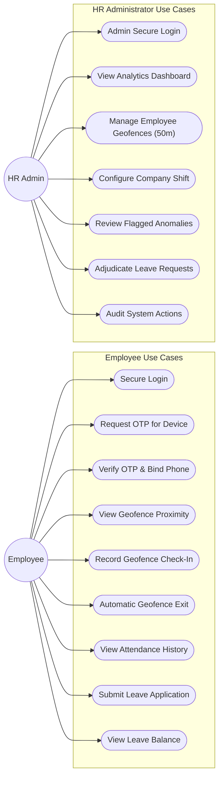
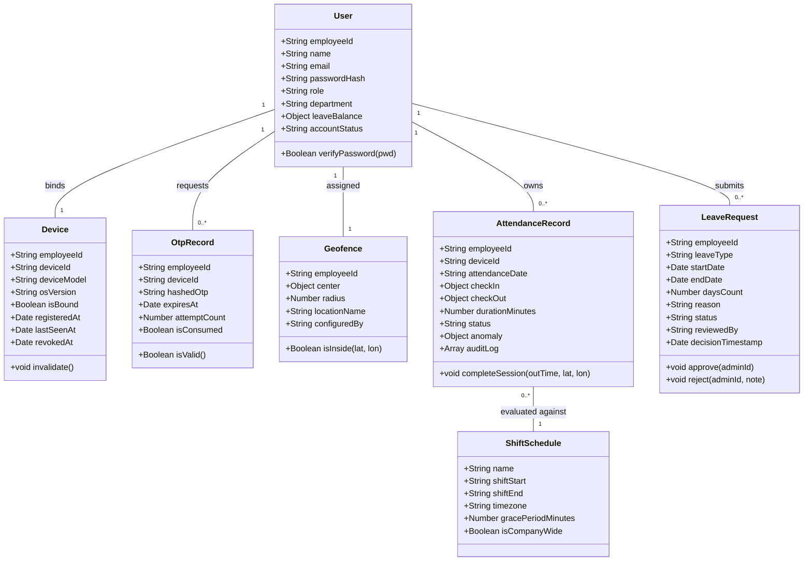
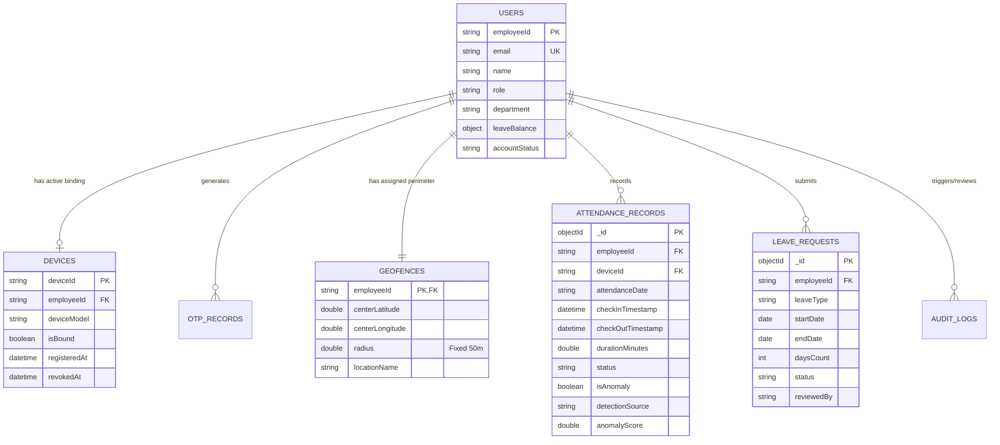
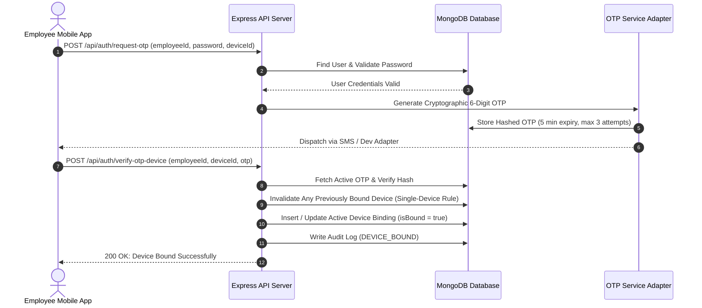
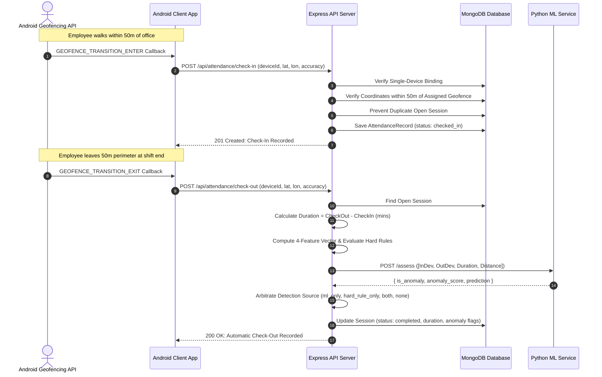
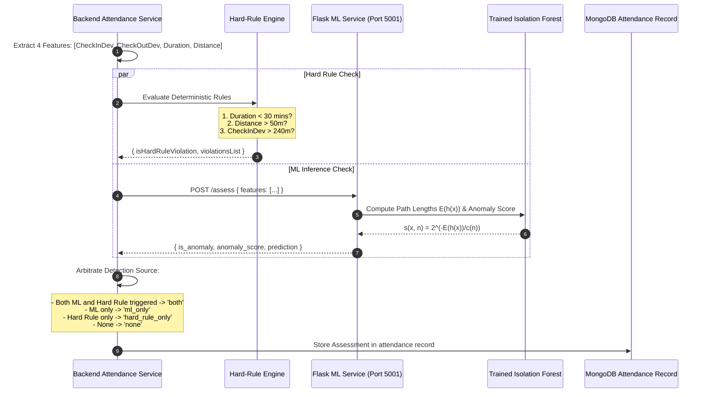

# System Architecture & Academic UML Design Specifications
## Geofence-Based Attendance Management System with ML Anomaly Detection

---

## 1. System Architecture Diagram

```mermaid
graph TD
    subgraph ClientLayer ["1. Client Application Layer"]
        A1["Android Native Mobile App<br/>(Play Services Geofencing)"]
        A2["HR Admin Web Dashboard<br/>(React.js + Vite)"]
        A3["Employee Web Portal<br/>(PWA / Geolocation Demo)"]
    end

    subgraph ApiGateway ["2. Backend Services & Security Layer"]
        B1["Express.js REST API Server<br/>(Port 5000)"]
        B2["JWT Auth & Role-Based Guard"]
        B3["Single-Device Binding & OTP Service"]
        B4["Haversine Geofence Validator (50m)"]
        B5["Hard-Rule Deterministic Engine"]
    end

    subgraph MlService ["3. Machine Learning Microservice"]
        C1["Flask Python ML Service<br/>(Port 5001)"]
        C2["Isolation Forest Engine<br/>(Contamination = 0.10)"]
        C3["4-Feature Feature Extractor"]
        C4["Synthetic Dataset Generator"]
    end

    subgraph DataLayer ["4. Persistence & Storage Layer"]
        D1["MongoDB Database<br/>(Local / Atlas Cluster)"]
        D2[("Users & Devices")]
        D3[("Attendance Records")]
        D4[("Geofences (50m)")]
        D5[("Leave Requests & Balances")]
        D6[("Audit Logs & Shift Schedules")]
    end

    A1 -->|HTTPS / REST API| B1
    A2 -->|HTTPS / REST API| B1
    A3 -->|HTTPS / REST API| B1

    B1 --> B2
    B1 --> B3
    B1 --> B4
    B1 --> B5

    B1 -->|POST /assess (4 Features)| C1
    C1 --> C2
    C2 --> C3

    B1 --> D1
    D1 --> D2
    D1 --> D3
    D1 --> D4
    D1 --> D5
    D1 --> D6
```

---

## 2. Data Flow Diagram (DFD Level 1)

```mermaid
flowchart TD
    E[Employee Device] -->|1. GPS Coordinates & Device ID| P1[Process 1.0: Geofence Validation]
    P1 -->|Query Coordinates & Radius| DB1[(Geofence Store)]
    DB1 -->|Center Lat/Lon, 50m Radius| P1
    
    P1 -->|2. Validated Inside 50m| P2[Process 2.0: Attendance Processing]
    P2 -->|Record Check-In/Exit| DB2[(Attendance Store)]
    
    P2 -->|3. On Exit: Duration & Deviations| P3[Process 3.0: 4-Feature Extraction]
    P3 -->|Vector: [InDev, OutDev, Dur, Dist]| P4[Process 4.0: ML Anomaly Assessment]
    
    P4 -->|Inference Query| ML[(Isolation Forest Model)]
    ML -->|Anomaly Score & Prediction| P4
    
    P3 -->|Duration & Distance| P5[Process 5.0: Hard-Rule Fallback]
    P5 -->|Violations (e.g. Dur < 30m)| P6[Process 6.0: Results Arbiter]
    P4 -->|ML Output| P6
    
    P6 -->|Combined Anomaly Flag & Source| DB2
    DB2 -->|Telemetry & Metrics| P7[Process 7.0: Analytics Aggregator]
    P7 -->|Summary & Anomaly Queues| A[HR Administrator]
```

---

## 3. Use-Case Diagram



---

## 4. Domain UML Class Diagram



---

## 5. Database ER-Style Schema



---

## 6. Sequence Diagrams

### 6.1 Authentication & Device Binding Sequence


### 6.2 Check-In and Automatic Checkout Sequence


### 6.3 Machine Learning Anomaly Detection Sequence

